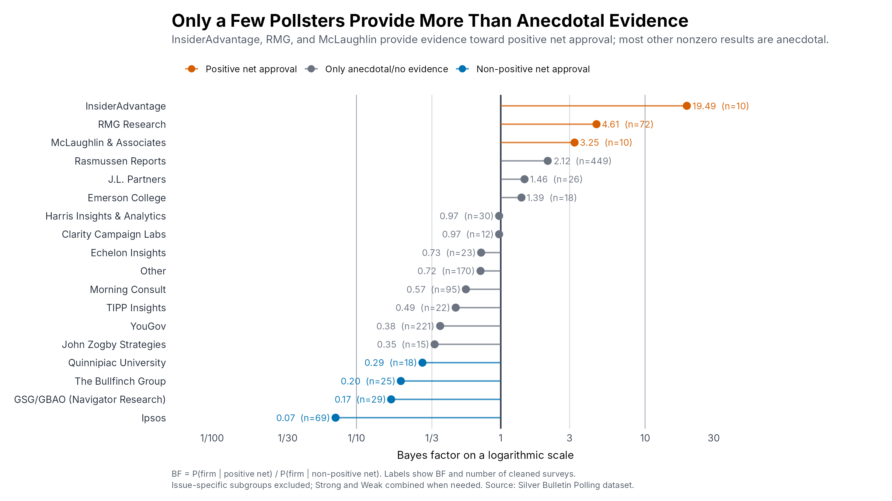
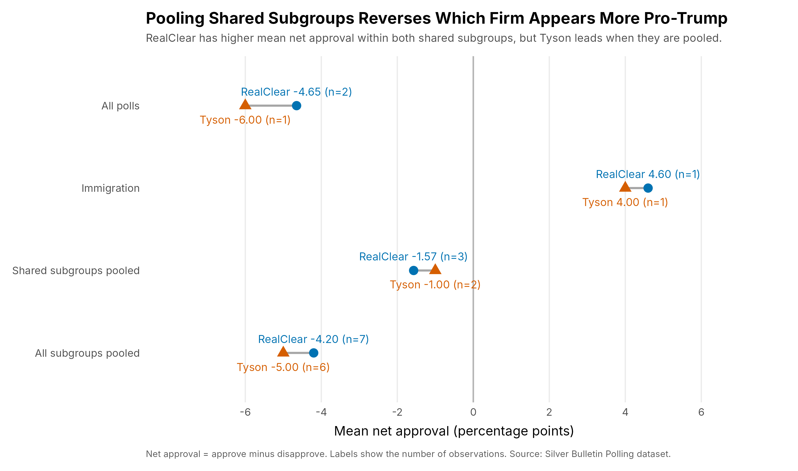
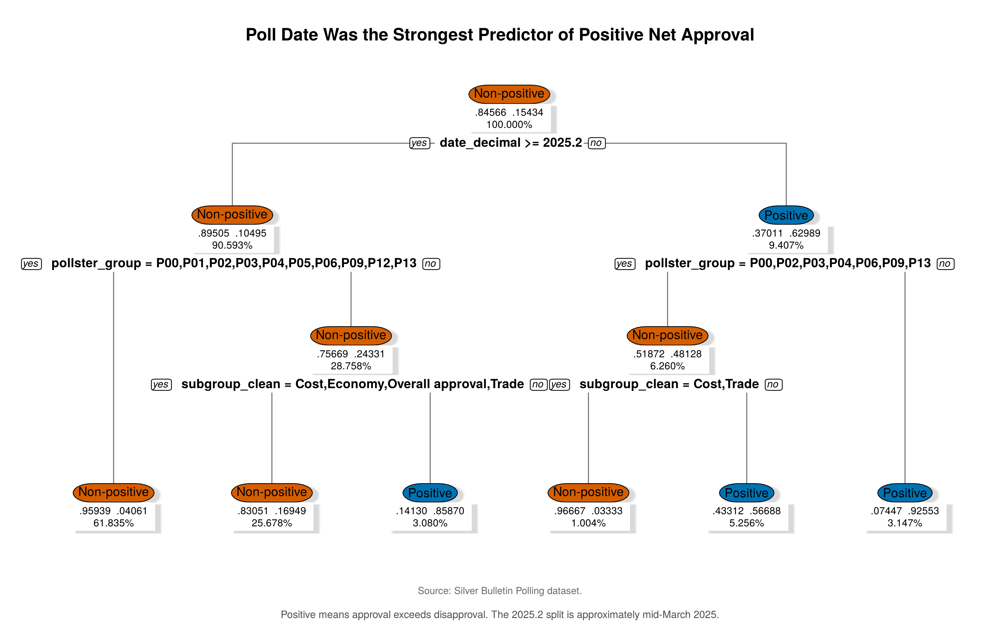
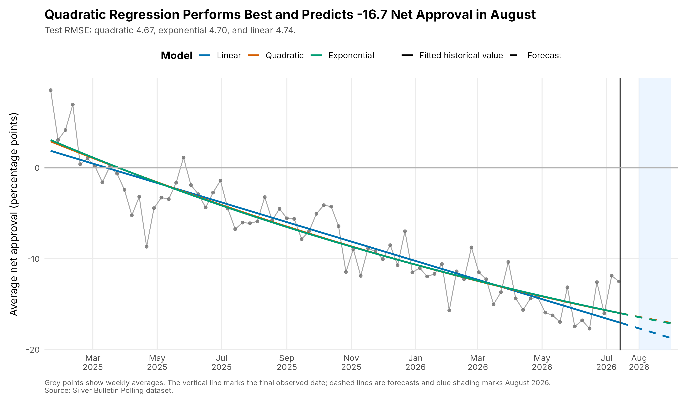

# Presidential Approval Polling Analysis

An analysis of 2025–2026 presidential approval polls from the Silver Bulletin polling dataset, done in R for my Data 101 final project at Rutgers (Summer 2026).

The raw data has 5,651 rows from 85 polling firms, but a single survey often appears on several rows (overall approval, Strong/Weak breakdowns, Adults vs. Voters, issue-specific questions). Most of the work was cleaning this into **one overall approval result per survey** before analyzing it.

## Questions and findings

### 1. Which pollsters lean positive or negative? (Bayes factors)
For each firm I computed a Bayes factor, BF = P(firm | positive net approval) / P(firm | non-positive net approval).

- **InsiderAdvantage** showed strong evidence of positive results (BF = 19.5); **RMG Research** (4.6) and **McLaughlin & Associates** (3.2) showed moderate evidence.
- **Ipsos** (0.07) showed strong evidence toward non-positive results.
- Most large firms (YouGov, Morning Consult, Echelon, Harris) were only anecdotal, meaning they mostly follow the general trend.
- Twelve firms had zero positive polls (BF = 0). With small sample sizes, that's a boundary result, not proof.



### 2. Simpson's paradox between two pollsters
RealClear Opinion Research had higher net approval than The Tyson Group **within both** subgroups they shared (All polls and Immigration). But when those subgroups are pooled, **Tyson comes out ahead**. That happens because Immigration makes up half of Tyson's observations but only a third of RealClear's.



### 3. What predicts a positive poll? (Decision tree)
A classification tree (rpart, depth 3, 10-fold CV) predicting whether a poll had positive net approval. **Poll date** was the strongest predictor (45.9% of variable importance), followed by subgroup (30.2%) and polling firm (23.8%). The first split falls around mid-March 2025.



### 4. Forecasting net approval for August 2026
I compared linear, quadratic, and exponential regression on a **chronological 80/20 split**: trained on 380 daily averages through March 27, 2026, and tested on the 96 days after that. I used a time-based split instead of a random one so the model never sees the future while training.

| Model | Train RMSE | Test RMSE | Test MAE |
|---|---|---|---|
| Linear | 4.52 | 4.74 | 3.70 |
| **Quadratic** | **4.50** | **4.67** | **3.49** |
| Exponential | 4.50 | 4.70 | 3.52 |

The quadratic model had the lowest test error and the smallest gap between train and test error, and it forecasts an average net approval of about **−16.7** for August 2026.



**Limitation:** test R² is slightly negative for all three models. Over the test window, they don't beat simply predicting the average. The models capture the long-run trend, but short-term movement is mostly noise, so the forecast should be read as a rough trend estimate.

## Data cleaning decisions
- Rows from the same survey were grouped by pollster, dates, sample size, population, and URL.
- For overall approval, "All polls" was preferred. Otherwise, Strong + Weak approve/disapprove were added together, and Adults or Voters were used as fallbacks.
- Issue-specific subgroups (Economy, Immigration, Trade, Cost) were excluded from the overall-approval analyses but kept as a predictor in the decision tree.
- Firms with fewer than 10 surveys were grouped as "Other" for the Bayes factors, and firms with fewer than 50 observations were grouped as "P00" for the tree.

## Repository structure
```
data/       Silver_Bulletin_Polling.csv (raw data)
R/          one script per analysis
figures/    graphs produced by the scripts
results/    CSV outputs (Bayes factors, model errors, variable importance, forecasts)
```

## How to run
1. Install packages: `install.packages(c("ggplot2", "rpart", "rpart.plot"))`
2. Set the working directory to `data/` (in RStudio: Session → Set Working Directory).
3. Run any script in `R/`, e.g. `source("../R/05_forecast.R")`. Graphs and CSVs are saved to the working directory.

## Tools
R, ggplot2, rpart, rpart.plot
